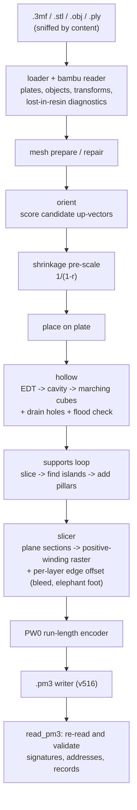

# travaso

Ports **Bambu Studio (.3mf)** projects to **Anycubic MSLA resin printers**, all the
way to a `.pm3` file ready for the USB stick: orientation, hollowing with verified
drainage, supports, light-bleed and shrinkage compensation, slicing, and a
binary encoder that re-reads its own output.

*Travaso* is Italian for decanting: pouring something from one vessel into another.

> **Status:** produces structurally consistent `.pm3` files that round-trip through
> the reader, but **no file has been printed on real hardware yet**. Read
> [Before printing](#before-printing) before starting a long print.

## Why

It is not a format converter. FDM (PLA) and MSLA (resin) are different processes,
and most of the work is translating the intent of an FDM project into something that
makes sense in resin: re-orient, support, hollow, and compensate for light that
spills past the lit pixels. Bambu Studio projects (multi-plate, multi-object,
painted supports, modifiers) carry information that does not survive into resin;
travaso tells you what is lost instead of silently dropping it.

## Quickstart

Python 3.11+.

```bash
git clone https://github.com/Tommycode3/bambu2resin.git && cd bambu2resin
python3 -m venv .venv && source .venv/bin/activate
pip install -e .
travaso printers                      # sanity check: lists the supported printer
```

The pipeline, in order:

```bash
travaso inspect project.3mf           # objects, plates, what will not survive in resin
travaso check project.3mf             # mesh health + repair (non-manifold edges reported)
travaso orient project.3mf --priority finish --alternatives 3
travaso calibrate exposure  --out tower.pm3      # do these once per resin
travaso calibrate tolerance --out plate.pm3
travaso build project.3mf --orient --out part.pm3
```

Everything on:

```bash
travaso build project.3mf \
  --orient --priority reliability \
  --hollow --wall 2.0 \
  --bleed 0.045 \
  --exposure 2.7 --bottom-exposure 30 --bottom-layers 6 \
  --layer-height 0.05 \
  --out part.pm3
```

`inspect`, `check`, `orient`, `slice` and `build` also accept `.stl`, `.obj` and
`.ply`, and detect the format from the file **content** (binary STLs renamed `.3mf`
are common). Every command has `--help`.

| command | purpose |
|---|---|
| `travaso inspect FILE` | project contents and what is lost in resin |
| `travaso check FILE` | mesh health, with repair |
| `travaso orient FILE` | recommended print pose and alternatives |
| `travaso slice FILE` | slice and report statistics, with PNG previews |
| `travaso build FILE --out X.pm3` | full pipeline to the print file |
| `travaso calibrate exposure\|tolerance --out X.pm3` | calibration test prints |
| `travaso printers` | supported printers and their parameters |

| option | default | effect |
|---|---|---|
| `--layer-height` | 0.05 | layer thickness, mm |
| `--orient` | off | apply the recommended pose |
| `--hollow --wall N` | off, 2.0 | hollow with an N mm wall and open drain holes |
| `--bleed N` | 0.0 | per-side growth of the part caused by light bleed (from the tolerance plate) |
| `--shrink-xy`, `--shrink-z` | 0.0 | resin shrinkage, percent |
| `--exposure`, `--bottom-exposure`, `--bottom-layers` | 2.5, 30, 6 | exposure times (from the tower) |
| `--no-supports` | supports on | do not generate supports and raft |
| `--spacing`, `--tip-diameter` | 4.0, 0.4 | support density and contact size, mm |

## How it works



### Orientation

In MSLA every layer is peeled off the vat film, and the peel force grows with the
layer's area. travaso samples candidate up-vectors $\mathbf{u}$ on the sphere with a
Fibonacci spiral (256 points) plus $\pm$ the normals of the 24 largest planar facets
(so "big face on the plate" is evaluated exactly), deduplicates directions closer than
about 1°, and scores each one from face normals $\mathbf{n}_f$ and areas $A_f$
without slicing:

$$
S(\mathbf{u}) = w_c \frac{X(\mathbf{u})}{\max_{\mathbf{u}'} X}
+ w_s \frac{\sum_f A_f \max(0, -\mathbf{n}_f\cdot\mathbf{u})}{\sum_f A_f}
+ w_h \frac{\sum_f A_f\, |\mathbf{n}_f\cdot\mathbf{u}|^{6}}{\sum_f A_f}
+ w_z \frac{H(\mathbf{u})}{\lVert \text{extents} \rVert}
$$

- $X(\mathbf{u})$: area of the convex hull's shadow on the plane normal to
  $\mathbf{u}$. It upper-bounds the largest cross-section and orders poses the same
  way, at a fraction of the cost of slicing every candidate.
- second term: downward-facing projected area, i.e. what must be supported (and
  where support scars will be).
- third term: area of near-horizontal faces; the exponent 6 isolates faces
  nearly perpendicular to the build direction, a proxy for peel forces.
- $H(\mathbf{u}) = \max_v \mathbf{v}\cdot\mathbf{u} - \min_v \mathbf{v}\cdot\mathbf{u}$:
  print height, i.e. layer count and time.

Poses that do not fit the build volume sort last; the lowest score wins. Weight
presets $(w_c, w_s, w_h, w_z)$: `reliability` (1.5, 1.0, 0.5, 0.4, default),
`speed` (0.8, 0.6, 0.4, 2.0), `finish` (1.0, 2.5, 0.5, 0.3, minimises support marks).
The normals-by-directions product is computed in blocks capped at 200 MB so it stays
bounded on meshes with hundreds of thousands of triangles.

### Slicing and the positive winding rule

Each layer is a plane-mesh intersection producing oriented segments, rasterised on
the panel grid (Photon M3: 4096 x 2560 pixels on 163.84 x 102.4 mm, i.e. exactly
40 µm square pixels, X mirrored because the panel is viewed from below through the
vat). The fill rule is the **positive winding number**:

$$
\text{pixel is solid} \iff w(\mathbf{p}) = \sum_{\text{contours}} \operatorname{wind}(\mathbf{p}) > 0
$$

The choice matters. Even-odd empties the overlap of two interpenetrating bodies
instead of uniting them; non-zero unites them but also fills an inverted primitive
($w=-1$) where it sticks out of the part. Positive winding **unites solids and
subtracts inverted primitives**, so cavities, drain holes and supports compose
without a single mesh boolean. Parity-based rasterisation also tolerates locally
non-watertight meshes, so repair is an improvement, not a prerequisite.

Anti-aliasing is deliberately asymmetric: horizontal coverage is computed exactly
from the real-valued span endpoints, vertically each pixel row is sampled with
`--antialias` sub-rows (default 4), so cost grows linearly with the sub-sample count
instead of quadratically. Only the bounding window of each layer is rasterised.

### Edge compensation (bleed, elephant foot, shrinkage)

Light bleeds past lit pixels and cures a thin shell around the part, so outer
dimensions grow and holes shrink by the same amount $b$ per side. Each layer's edge
is moved by a signed offset $\delta_k$ while preserving anti-aliasing: a signed
distance $d$ (in pixels) is rebuilt from Euclidean distance transforms inside and
outside, replaced on edge pixels by the fractional coverage $c-\tfrac12$ (more
precise than integer pixel counts), then

$$
c'_{ij} = \operatorname{clip}\!\left(d_{ij} + \frac{\delta_k}{p} + \tfrac12,\ 0,\ 1\right),
\qquad
\delta_k = -b - e\left(1 - \frac{k}{K}\right)\,[k < K]
$$

with pixel pitch $p$, elephant-foot extra growth $e$ tapered linearly over the first
$K$ layers. Shrinkage $r$ is compensated by pre-scaling the mesh by $1/(1-r)$, not
$1+r$: the part must be printed larger so that it returns to nominal *after*
shrinking (on a 3 % resin the difference is visible on long parts).

### Hollowing with verified drainage

The part is voxelised (default pitch 0.3 mm in `build`, capped at 12 M voxels to bound
memory). A Euclidean distance transform gives each solid voxel's distance $D$ to the
surface; the cavity is

$$
\Omega = \{\, \mathbf{x} : D(\mathbf{x}) > t + \tfrac{h}{2} \,\}
$$

where $t$ is the requested wall and $h$ the voxel pitch. The $h/2$ term compensates
two half-pitch biases (EDT measures between voxel centres; marching cubes places the
cavity surface half a pitch outward), so the achieved wall is $\min_\Omega D - h$ and
is reported. Connected components below 500 mm³ are dropped, and if the saving is
below 10 % of the solid volume the part is left solid: on thin parts the drain holes
would cost more than the cavity saves. The cavity surface is extracted with marching
cubes and **inverted**, so the positive winding rule subtracts it.

Each cavity gets two drain holes (3 mm): one at its lowest point (resin drains) and
one at its highest (air enters), as inverted cylinders. Then the air region is
flood-filled from the bounding-box border (connected-component labelling); a cavity
that is not reached is reported, because an undrained cavity is worse than a solid
part (trapped liquid resin, suction against the vat film).

### Supports, solved to a fixed point

An **island** is material that appears in layer $k$ with nothing beneath it: it cures
detached and floats in the vat. Islands are found on the rasterised layers, not on the
geometry, by labelling connected components of layer $k$ and keeping those that do
not touch layer $k-1$ dilated by one pixel. A sloped overhang may produce no island
and a harmless-looking part may produce dozens; this checks exactly what the printer
will cure.

Supports (tip 0.4 mm penetrating 0.15 mm, pillar 1.0 mm, raft 1.2 mm) are seeded at
the part's lowest points and on downward-facing surfaces within 45° of horizontal, i.e.
$n_z \le -\cos 45^\circ$ (about one
point per $s^2$ of projected area, thinned so no two are closer than the spacing $s$,
lowest first); pillars land on the raft or, when a ray cast straight down hits the model,
on the model itself. Placing supports changes what gets sliced (lifting the part off the plate turns
its bottom into an overhang), so the solver iterates: build, slice, find islands, add
supports at the remaining island centroids, repeat, up to `--rounds` (default 4). The stopping criterion is a check, not
a count: no islands left on the layers the printer will receive. Remaining islands
are reported.

### The .pm3 container and PW0 encoding

The `.pm3` layout (version 516) comes from UVtools' reverse-engineered
implementation (see [NOTICE.md](NOTICE.md)): a FileMark with table addresses, header,
RGB565 preview, grey table, a 32-byte record per layer, extra/machine tables, then
the layer data. Addresses are only known as the file is written, so the FileMark and
layer table are patched at the end.

Layers are encoded with PW0 run-length coding: each pixel is quantised to 4 bits;
runs of pure black or white (the vast majority) carry a 12-bit count over two bytes,
intermediate greys (edge anti-aliasing, short runs) a 4-bit count in one byte. A code
$c$ decodes to $(c \ll 4) \mid c$, so $0 \to 0$ and $15 \to 255$: extremes are exact.
After writing, `read_pm3` re-reads the file and checks signatures, addresses and
records; it also inspects files produced by Anycubic Photon Workshop for comparison.

## Key design decisions

| Decision | Why | Tradeoff |
|---|---|---|
| Positive winding fill instead of mesh booleans | Unions and subtractions (cavities, holes, supports) compose in the rasteriser; no fragile CSG on dirty meshes | Every primitive must be correctly oriented; an inverted one subtracts |
| Convex-hull shadow as cross-section proxy | Scores hundreds of poses in milliseconds | Upper bound, not exact; concave parts are over-estimated |
| Islands detected on raster layers | Measures what the printer cures, not what the geometry suggests | Each support round re-slices the whole part (tens of seconds on large parts) |
| Voxel EDT hollowing | Robust on non-watertight meshes, simple to reason about | Wall accuracy is about one voxel pitch, not hundredths of a mm |
| Machine data from UVtools/PrusaSlicer profiles, not spec sheets | Spec-sheet pixel sizes are inconsistent with panel geometry | One printer profile today |
| Encoder validated by its own reader | An encoder nobody reads back is unverifiable | Verified against itself, not yet against a physical print |

## Before printing

Exposure time and light bleed **cannot be derived**: they depend on resin, colour,
temperature and LCD ageing. travaso's defaults are plausible starting values, not a
calibrated profile. Two test prints measure them in an afternoon.

**Exposure tower.**
`travaso calibrate exposure --out tower.pm3 --from 1.5 --to 6.0 --steps 8`
prints 8 stacked bands, each with a different exposure: the format stores exposure
per layer, so 8 tests take one print (about 1 h 40 min, 6.6 ml in the default
configuration). Each band is slightly narrower than the one below so they can be
counted by eye, and has five progressively narrower slots on its face. Take the
**longest** time at which all slots are still open and edges are sharp, and pass it
as `--exposure`.

**Tolerance plate.**
`travaso calibrate tolerance --out plate.pm3 --exposure 2.7`
prints holes and pins of known diameter. Measure with calipers: holes come out
smaller and pins larger than nominal **by the same amount**; half of that amount is
the bleed, passed as `--bleed`. If both shift in the same direction it is a scale
error, not bleed: use `--shrink-xy`. Full instructions are written next to the
`.pm3` as a text file.

## Status and limitations

- **No file has been printed yet.** Structure is consistent and re-reads cleanly,
  but it is verified only against itself.
- Default exposure times are not calibrated: use the test prints.
- No automatic arrangement of multiple parts on the plate: with several
  individually oriented objects, poses can overlap.
- A residual lit area of 0.28 % of the cavity area, in two spots of about 1 mm, was
  measured inside cavities. Not enough to ruin a print, and not fully explained.
- Wall thickness is accurate to about one voxel pitch.
- Each support round re-slices the whole part.
- One printer in the registry (Anycubic Photon M3). Adding others is contained work:
  profiles live in `reference/`.

## Development

```bash
pip install -e ".[dev]"
pytest -q
```

Tests cover the parts where mistakes are invisible by eye: normal orientation, fill
rules, edge offset, binary file layout, island detection, hollowing and drainage.
Several are regression tests for real defects, and the docstring says which.

## License and credits

**AGPL-3.0-or-later.** The `.pm3` format was derived from
[UVtools](https://github.com/sn4k3/UVtools), which is AGPL-licensed; the credit for
decoding the format is theirs. See [NOTICE.md](NOTICE.md).
